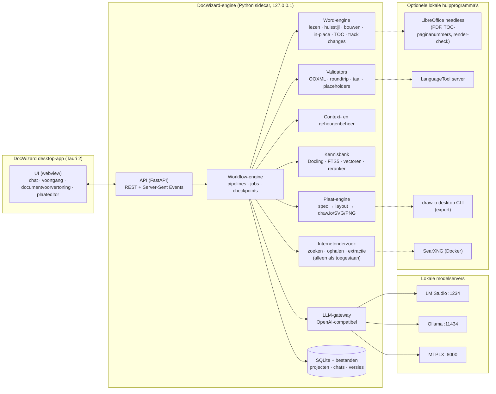
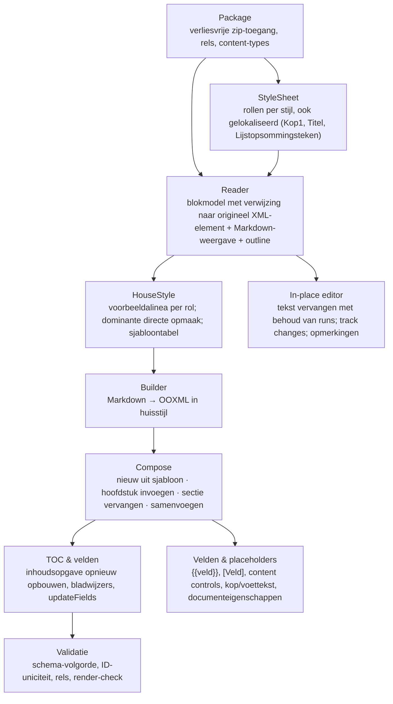
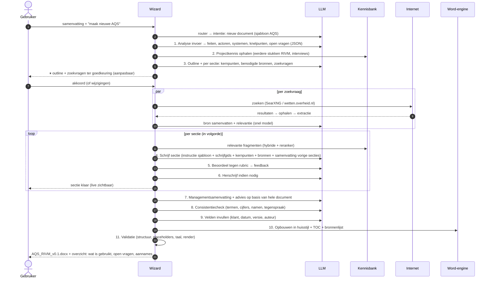
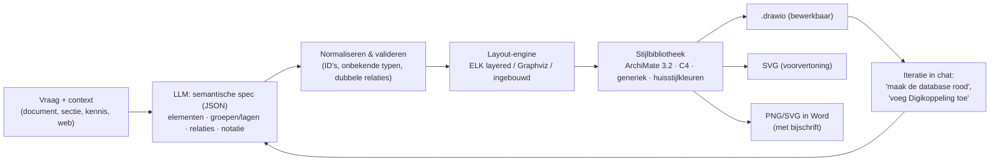

# DocWizard — Ontwerp

**Een lokale documentenwizard voor Word-documenten met huisstijl, aangedreven door lokale LLM's (LM Studio, Ollama, MTPLX).**

| | |
|---|---|
| Status | Ontwerp v0.1, ter review |
| Datum | 11 oktober 2026 |
| Platformen | macOS (Apple Silicon) en Windows 10/11 |
| Uitgangspunt | Er verlaat géén documentinhoud de machine, tenzij de gebruiker dat per chat expliciet toestaat (en dan alleen zoekvragen, nooit documenttekst) |

---

> ### Besluiten na review (11 oktober 2026) — gaan vóór de rest van dit document
> 1. **Geen Docker.** SearXNG en LanguageTool-in-Docker vervallen. Zoeken: DuckDuckGo (standaard, zonder sleutel, kan rate-limiten), Brave Search API (sleutel) of een eigen SearXNG-URL (optioneel, als die er al is). Correctie gebeurt door het LLM met bijgehouden wijzigingen; LanguageTool kan later als optionele lokale Java-server.
> 2. **Alles sequentieel in één sessie.** Eén job-wachtrij; LLM-aanroepen nooit parallel. Lange taken blijven zichtbaar per stap met live tekst.
> 3. **Eerst macOS, Windows makkelijk erachteraan.** Geen Tauri/Node in de MVP: Python-engine + web-UI in een native venster via **pywebview** (WKWebView / WebView2), gebouwd met **PyInstaller** (`scripts/build_mac.sh`, `scripts/build_windows.ps1`, GitHub Actions-matrix). Tauri blijft een optie voor later.
> 4. **Alle Word-documenten**: de engine is getest op een Engelstalig gestructureerde AQS (stijl-ID's `Heading1`) en een Nederlandstalige PA (`Kop1`, content-control-voorblad, DOCPROPERTY-velden, EMF-afbeeldingen, 78 koppen). Onbekende constructies blijven onaangeroerd.
> 5. **Instellingen → Taal en AI-API**: zelf URL, API-key en model opgeven voor elke OpenAI-compatibele lokale server, plus UI- en documenttaal.
> 6. **Denkmodellen**: bij gestructureerde (JSON) en snelle stappen wordt het "denken" uitgezet, anders gaat het tokenbudget op aan redeneren.

---

## Inhoud

1. [Probleem en doel](#1-probleem-en-doel)
2. [Ontwerpprincipes](#2-ontwerpprincipes)
3. [Kernbeslissing: Markdown, HTML of OOXML?](#3-kernbeslissing-markdown-html-of-ooxml)
4. [Hoe halen we cloudkwaliteit met een lokaal model?](#4-hoe-halen-we-cloudkwaliteit-met-een-lokaal-model)
5. [Architectuur op hoofdlijnen](#5-architectuur-op-hoofdlijnen)
6. [Technologiekeuzes en tooling](#6-technologiekeuzes-en-tooling)
7. [De Word-engine](#7-de-word-engine)
8. [Sjablonen (huisstijlen) en sjabloonprofielen](#8-sjablonen-huisstijlen-en-sjabloonprofielen)
9. [LLM-laag](#9-llm-laag)
10. [Workflow-engine (de "wizard")](#10-workflow-engine-de-wizard)
11. [Functies in detail](#11-functies-in-detail)
12. [Projecten, chats en sessies](#12-projecten-chats-en-sessies)
13. [Contextbeheer voor kleine contextvensters](#13-contextbeheer-voor-kleine-contextvensters)
14. [Kennisbank en zoeken (RAG)](#14-kennisbank-en-zoeken-rag)
15. [Internetonderzoek en privacymodi](#15-internetonderzoek-en-privacymodi)
16. [Architectuurplaten (draw.io)](#16-architectuurplaten-drawio)
17. [Gebruikersinterface en transparantie](#17-gebruikersinterface-en-transparantie)
18. [Beveiliging, privacy en compliance](#18-beveiliging-privacy-en-compliance)
19. [Kwaliteitsborging en testen](#19-kwaliteitsborging-en-testen)
20. [Prestaties](#20-prestaties)
21. [Packaging en distributie](#21-packaging-en-distributie)
22. [Uitbreidbaarheid](#22-uitbreidbaarheid)
23. [Roadmap](#23-roadmap)
24. [Risico's en maatregelen](#24-risicos-en-maatregelen)
25. [Open vragen](#25-open-vragen)
26. [Bijlagen](#26-bijlagen)

---

## 1. Probleem en doel

### 1.1 Probleem
Publieke cloud-AI mag op het werk niet gebruikt worden voor het maken of aanpassen van documenten. Juist daar levert AI veel op: Architecture Quick Scans (AQS), Project Start Architecturen (PSA), onderzoeken, adviezen, cv's en vertalingen. Lokale modellen zijn er wel (Qwen 3.8 via MTPLX/LM Studio, Gemma 4 via Ollama), maar:

- ze hebben geen kant-en-klare koppeling met Word en de huisstijl;
- ze zijn kleiner en zwakker dan cloudmodellen, en hun praktische context is beperkt;
- ze hebben geen geheugen over sessies heen;
- ze maken geen bruikbare architectuurplaten.

### 1.2 Doel
Een desktopapplicatie voor macOS en Windows die:

| # | Functie | Voorbeeld |
|---|---|---|
| F1 | **Nieuw document maken** vanuit een huisstijlsjabloon | "Maak op basis van deze meetingsamenvatting een nieuwe AQS voor RIVM" |
| F2 | **Hoofdstuk toevoegen / documenten samenvoegen**, inclusief bijgewerkte inhoudsopgave en nummering | "Voeg dit nieuwe hoofdstuk toe aan de PSA, na hoofdstuk 4" |
| F3 | **Vertalen** met behoud van exacte lay-out | NL → EN van een complete PSA |
| F4 | **Corrigeren** met *Wijzigingen bijhouden* (track changes) | Spelling, grammatica, B1-taalniveau, terminologie |
| F5 | **Reviewen** met Word-opmerkingen (comments) | "Review deze AQS op volledigheid en consistentie" |
| F6 | **Verrijken** met extra informatie (projectkennis en internet) | "Vul de paragraaf wet- en regelgeving aan" |
| F7 | **Architectuurplaten** als bewerkbaar draw.io-bestand, ook ingevoegd in Word | "Maak een ArchiMate-plaat van de doelarchitectuur" |
| F8 | **Lay-out toepassen**: een bestaand of "lelijk" document omzetten naar de huisstijl | Een aangeleverd hoofdstuk in de PSA-huisstijl gieten |
| F9 | **Sessies hervatten**, ook na een week en na wisselen van model | Doorwerken aan de AQS RIVM-chat |
| F10 | **Privacymodi per chat**: privé, project, alle projecten, internet | AQS RIVM: project + internet. Gevoelig dossier: privé |

### 1.3 Niet-doelen (voorlopig)
- Geen samenwerking met meerdere gebruikers of een server. Eén gebruiker op één machine; wel exporteerbaar.
- Geen eigen tekstverwerker. Word blijft de editor, DocWizard maakt en bewerkt bestanden.
- Geen training of fine-tuning van modellen in v1. Een LoRA op eigen AQS'en staat wel op de roadmap.

---

## 2. Ontwerpprincipes

1. **Lokaal is de norm.** Alle verwerking gebeurt op de machine. Netwerkverkeer gaat alleen naar `localhost` (LLM-servers), tenzij de gebruiker internetonderzoek per chat aanzet. Dat wordt technisch afgedwongen in de netwerklaag, niet alleen in de prompt.
2. **Gereedschap boven model.** Alles wat deterministisch kan (lay-out, nummering, inhoudsopgave, tabellen, plaatlay-out, spellingcontrole, controles) doet code. Het model doet alleen wat alleen een model kan: begrijpen, formuleren, structureren en beoordelen.
3. **Het originele document is heilig.** We bewerken het echte OOXML-bestand en kopiëren de huisstijl van voorbeelden uit het sjabloon. We bouwen het document nooit opnieuw op uit een verliesgevende tussenvorm.
4. **Klein werk per modelaanroep.** Een lokaal model presteert het best met korte, scherp afgebakende taken: één sectie, één alinea-batch, één beoordeling. De workflow-engine knipt grote opdrachten op.
5. **Altijd zichtbaar wat er gebeurt.** Elke stap is zichtbaar in de UI met status, tussenresultaten, geraadpleegde bronnen en de live tokenstroom. Lang duren mag, onduidelijk zijn niet.
6. **Mens in de lus op de juiste momenten.** Een outline, onderzoeksvragen of een plaatontwerp mag de gebruiker goedkeuren of bijsturen voordat er een half uur gegenereerd wordt.
7. **Modelonafhankelijk.** Alle state (chat, samenvattingen, besluiten, documentversies) staat in de eigen database. Wisselen van model of server kost niets.
8. **Verifieerbaar.** Elke output wordt gecontroleerd door validators (OOXML-validiteit, lay-out-roundtrip, placeholders, taal, bronvermelding) voordat de gebruiker hem krijgt.

---

## 3. Kernbeslissing: Markdown, HTML of OOXML?

De vraag was: exporteren we de lay-out, schrijven we in Markdown en zetten we de lay-out terug? Of zetten we Word om naar HTML, passen we dat aan en zetten we het terug naar Word?

### 3.1 Wat er in een huisstijldocument zit
Een corporate Word-document is meer dan opgemaakte tekst:

- stijlen (vaak met gelokaliseerde ID's zoals `Kop1`, `Standaard` en `Lijstopsommingsteken`) en eigen stijlen ("AQS Body");
- **directe opmaak** die niet in stijlen staat (heel gebruikelijk in sjablonen die door de jaren heen zijn gegroeid);
- meerlaagse kopnummering via `numbering.xml`, gekoppeld aan stijlen;
- secties met eigen kop- en voetteksten, een afwijkende eerste pagina, liggende pagina's en kolommen;
- een voorblad met inhoudsbesturingselementen (content controls), tekstvakken, logo's en achtergronden;
- velden: inhoudsopgave (TOC), PAGE, SEQ (figuurnummers), REF/PAGEREF (kruisverwijzingen), DATE en DOCPROPERTY;
- tabellen met tabelstijlen, gekleurde koprijen, samengevoegde cellen en een herhalende koprij;
- thema (kleuren en lettertypen), ingesloten lettertypen, aangepaste XML, eigenschappen en metadata;
- voetnoten, opmerkingen, bijgehouden wijzigingen en bladwijzers.

### 3.2 Vergelijking

| Criterium | A. Markdown + lay-out terugzetten (bv. Pandoc `--reference-doc`) | B. Word → HTML → Word (bv. Mammoth/LibreOffice) | **C. OOXML-native met Markdown als werktaal (gekozen)** |
|---|---|---|---|
| Stijlen en thema | Gedeeltelijk: alleen stijlen met bekende namen | Grotendeels verloren; HTML kent geen Word-stijlen | **Volledig: originele bestanden blijven staan** |
| Directe opmaak uit sjabloon | Verloren | Deels als inline CSS, terugzetten is onbetrouwbaar | **Behouden: gekloond van voorbeeldalinea's** |
| Voorblad, content controls, tekstvakken | Verloren | Verloren of verminkt | **Behouden** |
| Kop- en voetteksten, secties | Alleen uit het referentiedocument, niet per sectie | Verloren | **Behouden** |
| Kopnummering | Deels | Verloren (wordt platte tekst) | **Behouden: via de stijl** |
| Inhoudsopgave en velden | Nieuw veld, cache leeg | Verloren (wordt platte tekst) | **Behouden en opnieuw opgebouwd** |
| Tabelopmaak (koprij, kleuren) | Generieke tabelstijl | Deels | **Gekloond van sjabloontabel** |
| Vertalen of corrigeren zonder lay-outverlies | Nee: het hele document wordt opnieuw opgebouwd | Nee | **Ja: tekst wordt per alinea vervangen in het origineel** |
| Bijgehouden wijzigingen en opmerkingen | Nee | Nee | **Ja** |
| Wat het LLM ziet | Markdown (goed) | HTML (veel ruis, kost tokens) | **Markdown (goed)** |
| Complexiteit | Laag | Middel | Hoog, maar eenmalig en volledig in onze controle |

### 3.3 Besluit
**Variant C: OOXML-native, met Markdown als werktaal voor het model.**

- **Het LLM leest en schrijft Markdown.** Dat is compact (tokenzuinig), het model beheerst het goed en het is goed controleerbaar. HTML kost twee tot drie keer zoveel tokens en lokale modellen maken er meer fouten in.
- **De Word-engine vertaalt Markdown naar OOXML** in de huisstijl van het doel­document. Per rol (kop 1–9, platte tekst, opsomming, nummering, citaat, bijschrift, tabel) zoekt de engine een **voorbeeld** in het sjabloon en kloont daarvan de paragraaf-, run- en tabeleigenschappen. Nieuwe inhoud ziet er daardoor precies zo uit als inhoud die de sjabloonmaker zelf heeft getypt.
- **Er zijn twee bewerkingsmodi:**
  1. **In-place** (vertalen, corrigeren, reviewen): alleen de tekst in bestaande alinea's verandert. Opmaak binnen een alinea (vet of een link midden in een zin) wordt bewaakt met genummerde markeringen. Alles buiten de tekst blijft byte-voor-byte gelijk.
  2. **Genereren of invoegen** (nieuw document, hoofdstuk, sectie, verrijking): het voorblad, de inhoudsopgave, de secties en kop- en voetteksten van het sjabloon blijven staan. Alleen de body-inhoud wordt gegenereerd en ingevoegd, waarna de inhoudsopgave en velden worden bijgewerkt.
- **Het pakket blijft verliesvrij.** Het .docx-bestand wordt als zip ingelezen en alleen de onderdelen die we aanpassen worden opnieuw geserialiseerd. Thema, lettertypen, kop- en voetteksten en aangepaste XML gaan ongewijzigd mee.
- **Pandoc, Mammoth en Docling zijn alleen hulpmiddelen,** geen kernroute:
  - **Docling** voor het *lezen* van bronmateriaal (pdf, pptx, xlsx, html, gescande documenten);
  - **Mammoth of docx-preview** voor een *HTML-voorvertoning* in de UI;
  - **Pandoc** als noodroute voor exotische invoerformaten (odt, rtf, LaTeX).

---

## 4. Hoe halen we cloudkwaliteit met een lokaal model?

Cloudmodellen zijn sterker in redeneren, kennis, lange context en betrouwbare toolaanroepen. Een groot deel van dat verschil kunnen we compenseren:

| Zwakte lokaal model | Compensatie in DocWizard |
|---|---|
| Kleiner effectief contextvenster: kwaliteit zakt ruim voor het maximum | Werk per sectie; contextbudget per stap (§13); samenvattingslagen; ophalen van alleen relevante fragmenten (RAG + reranker) |
| Minder kennis, verouderde kennis | Internetonderzoek met bronnen (§15); projectkennisbank; vaste kennispakketten (NORA, BIO, AVG, Woo, Archiefwet, GEMMA, Common Ground) die lokaal geïndexeerd zijn |
| Hallucinaties | Brongebonden schrijven: elke bewering in "verrijk"-modus moet een bron-ID hebben; daarna een feitencheck die beweringen tegen de bronnen legt |
| Zwakker in lange documentstructuur | Eerst een outline (met goedkeuring), dan per sectie schrijven met de outline en eerdere samenvattingen als context: *skeleton-of-thought* |
| Inconsistente stijl en terminologie | Schrijfgids per sjabloon (toon, lengte, voorbeeldalinea's); termenlijst per project; consistentiecheck over het hele document |
| Onbetrouwbare toolaanroepen of agents | Deterministische pipelines in plaats van vrije agents; afgedwongen gestructureerde output (JSON-schema of grammar); automatische reparatie en herpogingen |
| Matige eerste versies | Schrijf → beoordeel met rubric → herschrijf (1–2 rondes); meerdere kandidaten en de beste kiezen voor kritieke stukken zoals managementsamenvatting en advies |
| Taalfouten | LanguageTool (lokaal) en spellingscontrole achteraf, als echte bijgehouden wijzigingen |
| Slechte plaatlay-out | Het model levert alleen de semantiek (JSON); layoutalgoritmes (ELK/Graphviz) en een stijlbibliotheek doen de rest |
| Traag | Snelle modellen voor routering en classificatie, het zware model alleen voor schrijfwerk; parallelle aanroepen; speculatieve decoding (MTPLX); KV-cachehergebruik; voortgang zichtbaar en hervatbaar |

**Verwachting:** voor documenttypen met een vaste structuur (AQS, PSA, adviesnota, cv) is "goed genoeg om na een korte redactieslag te versturen" haalbaar met een model van ±27–35B. Vrij redeneerwerk blijft zwakker dan in de cloud. Daar helpen de mens-in-de-lusmomenten.

---

## 5. Architectuur op hoofdlijnen



**Waarom een Python-engine?** Het beste documentgereedschap is Python: lxml, python-docx, Docling, trafilatura, LanguageTool-clients, Pillow en ML-tooling. De UI is web-technologie in een native schil.

**Proces- en communicatiemodel**
- De engine draait als sidecar-proces dat door de desktopschil wordt gestart, op `127.0.0.1` met een willekeurige poort en een geheim sessietoken. Andere programma's op de machine kunnen er dus niet bij.
- Lange taken zijn **jobs**: ze krijgen een ID, sturen events (stap, log, token, bron, artefact, vraag-aan-gebruiker) via Server-Sent Events en hebben checkpoints in SQLite. Na een crash of herstart gaat een job verder vanaf het laatste checkpoint.
- Eén job-wachtrij per LLM-server, zodat niet drie zware taken tegelijk dezelfde GPU/ANE belasten. Zelf in te stellen.

---

## 6. Technologiekeuzes en tooling

> Versies zijn een momentopname. Bij de bouw zetten we alles vast in `uv.lock` en `package-lock`. Een *doctor*-scherm in de app controleert de versies en meldt updates.

### 6.1 Applicatie

| Onderdeel | Keuze | Waarom | Alternatief |
|---|---|---|---|
| Desktopschil | **Tauri 2** | Klein (enkele MB's), gebruikt de native webview (WKWebView op macOS, WebView2 op Windows), veilige permissies, auto-updater, codesigning en notarisatie | Electron (groter, maar makkelijker); pywebview (snelste MVP) |
| UI-framework | **React + TypeScript + Vite**, met shadcn/ui en Tailwind | Groot ecosysteem: chat-UI, Monaco/CodeMirror, diff-views, pdf.js | Svelte 5 |
| Engine | **Python 3.12 + FastAPI + Pydantic v2 + uvicorn** | Beste document- en ML-ecosysteem | — |
| Pakketbeheer | **uv** | Snel en reproduceerbaar | Poetry |
| Python-bundeling | **PyInstaller** (of Nuitka) als sidecar-binary per OS | Werkt met Tauri-sidecars | Python-runtime meeleveren via `python-build-standalone` |
| Database | **SQLite** (WAL) met **FTS5** + **sqlite-vec** voor vectoren | Eén bestand, robuust en snel genoeg voor tienduizenden fragmenten | LanceDB |
| Encryptie in rust (optioneel) | **SQLCipher**, sleutel in macOS Keychain / Windows DPAPI | Gevoelige klantinformatie | Versleuteld volume (FileVault/BitLocker) |

### 6.2 Documenten

| Taak | Tool | Opmerking |
|---|---|---|
| Lezen en schrijven van .docx (kern) | **Eigen OOXML-engine op lxml** (deels al gebouwd) | Verliesvrij, huisstijl via voorbeelden, zie §7 |
| Hulp bij docx-API | **python-docx ≥ 1.2** | Handig voor tests en eenvoudige taken; ondersteunt sinds 1.2 opmerkingen |
| Documenten samenvoegen | Eigen merge, met **docxcompose** als referentie | docxcompose lost stijl- en nummeringsconflicten op bij samenvoegen; die aanpak nemen we over |
| Invoer van andere formaten | **Docling** (2.11x+, IBM, MIT) met **Granite-Docling-258M** | PDF, PPTX, XLSX, HTML en scans naar gestructureerde Markdown/JSON, met tabellen en lees­volgorde; volledig lokaal |
| OCR | Docling-pipeline, met **ocrmac** (Apple Vision) op macOS en **RapidOCR/Tesseract** op Windows | Voor gescande pdf's |
| Markdown-parser | **markdown-it-py** (+ tabellen) | Robuust en CommonMark-conform |
| PDF-export, inhoudsopgave-paginanummers, render-check | **LibreOffice headless** (optioneel, eenmalig te downloaden) | `soffice --headless --convert-to pdf`; ook voor een visuele controle (§19). Zonder LibreOffice werkt Word de inhoudsopgave bij bij openen (`updateFields`) |
| Voorvertoning in de UI | **docx-preview** (JS) voor snelle weergave; PDF via LibreOffice + **pdf.js** voor een paginagetrouwe weergave | |
| Word-sjablonen met variabelen (optioneel) | Herkenning van `{{veld}}`, `<<veld>>`, `[Veld]` en content controls; geen Jinja-afhankelijkheid nodig | **docxtpl** als optie voor zware sjablonen met lussen |

### 6.3 Taal en kwaliteit

| Taak | Tool |
|---|---|
| Spelling en grammatica (NL/EN/DE/FR) | **LanguageTool** als lokale server (Java, of Docker), met de Nederlandse regels. Draait volledig offline. |
| Leesbaarheid / B1 | Eigen metrieken (zinslengte, woordlengte, passief, nominalisaties) en een LLM-check op de "Direct duidelijk"-richtlijnen |
| Taaldetectie | **lingua-py** (nauwkeurig op korte teksten) |
| Detectie van persoonsgegevens (voor de zoekvraag-firewall) | **Microsoft Presidio** met NL-patronen (BSN, IBAN, postcode, telefoon) en de NER uit het lokale LLM |
| Terminologie | Eigen termenlijst per project/sjabloon (TBX-import mogelijk) |

### 6.4 Kennis en zoeken

| Taak | Tool |
|---|---|
| Embeddings | **Qwen3-Embedding-0.6B** (meertalig, Apache 2.0, lokaal via LM Studio, Ollama of `llama.cpp`); fallback **nomic-embed-text v1.5** (staat al in LM Studio) |
| Reranker | **Qwen3-Reranker-0.6B** (cross-encoder), voor de top-30 → top-8 |
| Lexicaal zoeken | SQLite **FTS5** (BM25), met Nederlandse stemming via Snowball |
| Fusie | Reciprocal Rank Fusion van BM25 en vector, daarna de reranker |

### 6.5 Internet (alleen als toegestaan)

| Taak | Tool |
|---|---|
| Zoeken | **SearXNG** lokaal in Docker (aanbevolen: geen API-sleutel, aggregeert meerdere zoekmachines, geen tracking); alternatieven: Brave Search API, DuckDuckGo (HTML) |
| Pagina's ophalen | **httpx**, met **Playwright** (headless Chromium) als noodroute voor JavaScript-zware sites |
| Hoofdtekst extraheren | **trafilatura** |
| Juridische bronnen | **wetten.overheid.nl** (SRU-zoekdienst en BWB-XML), **EUR-Lex**, **officielebekendmakingen.nl**, **Open Overheid / Woo-index** |
| Architectuurkennis | NORA, GEMMA, Forum Standaardisatie (pas-toe-of-leg-uit), BIO, Logius, NCSC: periodiek lokaal te indexeren als "kennispakket" |

### 6.6 Platen

| Taak | Tool |
|---|---|
| Layout | **ELK** (Eclipse Layout Kernel, via **elkjs** in de UI of als Node-sidecar) voor layered/orthogonale layout met containers; **Graphviz** als alternatief; eigen layered layout als ingebouwde noodroute |
| Uitvoer | Eigen generator naar **draw.io mxGraph-XML** (bewerkbaar), **SVG** en **PNG** (Pillow) |
| Export en vormen (optioneel) | **draw.io desktop CLI** (`drawio -x -f png/svg/pdf`), offline |
| Bewerken in de app | Ingebed **draw.io-editor** (open source, lokaal gebundeld, `embed=1`, zonder internet) zodat platen in DocWizard zelf aan te passen zijn |
| Alternatieve notaties | Mermaid, PlantUML (C4-PlantUML), Structurizr DSL: export als bonus |

### 6.7 Overig

| Taak | Tool |
|---|---|
| Meeting-opnames transcriberen (bonus) | **whisper.cpp** / **mlx-whisper** (macOS) / **faster-whisper** (Windows), lokaal |
| Gestructureerde output | JSON-schema via de server (LM Studio en Ollama ondersteunen dit; bij MTPLX controleren), plus **eigen validatie, reparatie en herpoging** met Pydantic |
| Logging en tracing | Gestructureerde logs (JSON), per job een trace met prompts, outputs en timings; lokaal in te zien |

---

## 7. De Word-engine

De Word-engine is de kern van de belofte "exact dezelfde lay-out". Hij bestaat uit lagen:



### 7.1 Package (verliesvrij)
- Leest elk onderdeel als bytes. Alleen onderdelen die we wijzigen worden geparsed en opnieuw geschreven, met de originele volgorde in de zip en `[Content_Types].xml` vooraan.
- Beheert relaties (`_rels/*.rels`), content types, unieke medianamen en een unieke `docPr`-ID en bladwijzer-ID.
- *Status: gebouwd* (`src/docwizard/wordengine/package.py`).

### 7.2 Stijlen en rollen
- Word bewaart ingebouwde stijlnamen altijd in het Engels (`heading 1`), maar de stijl-ID is gelokaliseerd (`Kop1`). We herkennen beide, in NL, EN, DE, FR, ES, IT en de Scandinavische talen, plus eigen stijlen via `basedOn`-ketens en `outlineLvl`.
- Rollen: titel, ondertitel, kop 1–9, platte tekst, opsomming, nummering, lijstalinea, citaat, code, bijschrift, inhoudsopgave-niveaus, tabel en hyperlink.
- *Status: gebouwd* (`styles.py`).

### 7.3 Reader en blokmodel
- Leest body-elementen in volgorde: alinea, tabel, content control (`sdt`), sectie-einde.
- Classificeert elk blok: kop (met niveau), alinea, lijst (niveau, geordend of niet, via `numbering.xml`), tabel (cellen), inhoudsopgave, afbeelding, paginascheiding of overig. Elk blok houdt een verwijzing naar het **originele XML-element**.
- Produceert:
  - **Markdown** (optioneel met blok-ID's: `<!-- b42 -->`) voor het model;
  - een **outline** met hoofdstuknummers ("2.3") en het blokbereik per sectie;
  - **statistieken** (woorden, tabellen, afbeeldingen).
- *Status: gebouwd en getest op het voorbeeldsjabloon* (`reader.py`). Een kleine verbetering staat open: de TOC-veldalinea met cachetekst wordt nu als alinea gezien.

### 7.4 HouseStyle: huisstijl leren van voorbeelden
- Per rol kiezen we een **voorbeeldalinea** uit het sjabloon (de meest gebruikte stijl voor die rol) en klonen we de `pPr` (alinea-eigenschappen).
- **Dominante directe opmaak:** als ≥ 60% van de tekst in een rol dezelfde directe run-opmaak heeft (bijvoorbeeld handmatig Arial 10), nemen we die over.
- **Instructietekst herkennen:** sjablonen bevatten vaak aanwijzingen zoals *"[Beschrijf hier de aanleiding]"* in grijs en cursief. Die worden herkend (haken, tijdelijke-aanduidingsstijl, markering, grijs+cursief). Ze worden niet gebruikt als stijlvoorbeeld en verdwijnen uit de output, maar worden wél als **schrijfinstructie** per sectie aan het model gegeven.
- **Sjabloontabel:** de eerste tabel in de body is het voorbeeld voor tabelstijl, randen, koprij-arcering, lettertype en celmarges.
- *Status: gebouwd* (`housestyle.py`).

### 7.5 Builder: Markdown → OOXML
- Koppen: stijl uit het voorbeeld. Als de koppen automatisch genummerd zijn, verwijderen we handmatige nummers die het model zelf schrijft ("2.1 Aanleiding" wordt "Aanleiding"). Elke kop krijgt een `_Toc`-bladwijzer.
- Lijsten: de lijststijl van het sjabloon. Genummerde lijsten herstarten per lijst (nieuwe `w:num` met `startOverride`). Ontbreekt een lijstdefinitie, dan maken we een nette definitie aan in `numbering.xml`.
- Tabellen: de sjabloontabel wordt gekloond (tblPr, koprij, wisselende rijkleuren), met kolombreedtes naar inhoud binnen de tekstbreedte en een herhalende koprij.
- Afbeeldingen (zoals platen): ingevoegd als inline drawing en geschaald op de tekstbreedte, met een bijschrift met een `SEQ Figuur`-veld (automatische nummering).
- Links, vet, cursief, doorhalen en code. Citaat- en codeblokken krijgen sjabloonstijlen of nette standaardstijlen.
- Paginascheiding via `<!-- pagebreak -->`.
- **Schemavolgorde:** Word weigert bestanden met eigenschappen in de verkeerde volgorde. Alle invoegingen gaan via een helper die de schemavolgorde kent (`order.py`).
- *Status: gebouwd, nog niet end-to-end getest.*

### 7.6 Compose-operaties

| Operatie | Wat er gebeurt |
|---|---|
| `new_from_template(sjabloon, body_md, velden)` | Het voorblad, de inhoudsopgave en de secties tot de eerste kop blijven staan. De body (vanaf de eerste kop tot de laatste `sectPr`) wordt vervangen door gegenereerde inhoud. Daarna worden de velden ingevuld en de inhoudsopgave opnieuw opgebouwd. |
| `insert_chapter(doc, md\|docx, positie)` | Invoegen na hoofdstuk X, aan het eind of vóór de bijlagen. Kopniveaus worden verschoven (een H1-hoofdstuk kan als H2 worden ingevoegd). Een bron-docx wordt eerst gelezen en daarna **in de huisstijl van het doel** opnieuw opgebouwd, inclusief afbeeldingen. |
| `replace_section(doc, sectie, md)` | Eén sectie herschrijven of verrijken. Kop en subsecties blijven optioneel staan. |
| `merge(docs[], volgorde)` | Meerdere documenten tot één, in de huisstijl van het eerste of van een gekozen sjabloon. |
| `restyle(doc, sjabloon)` | Een willekeurig document in de huisstijl van een sjabloon gieten (F8). |

Wat er altijd na een compose-operatie gebeurt:
- **Inhoudsopgave:** zowel de `sdt`-variant als het losse TOC-veld wordt gevonden. De cache-items (hyperlinks naar bladwijzers met `PAGEREF`-velden) worden opnieuw opgebouwd zodat de inhoudsopgave direct klopt. Daarnaast zetten we `w:updateFields` in `settings.xml`, zodat Word bij openen ook de paginanummers bijwerkt. Is LibreOffice aanwezig, dan kunnen we de paginanummers ook vooraf bijwerken.
- **Figuur- en tabelnummers** via `SEQ`-velden. Kruisverwijzingen ("zie hoofdstuk 3") worden als `REF`-velden naar bladwijzers gemaakt waar het model naar een kop verwijst.
- **Documenteigenschappen:** titel, gewijzigd-datum en "laatst gewijzigd door".

### 7.7 In-place editor (vertalen, corrigeren, reviewen)
- **Segmentatie:** per alinea (ook in tabellen, kop- en voetteksten, voetnoten en tekstvakken) voegen we runs met dezelfde opmaak samen tot *spans*.
  - Eén span: platte tekst.
  - Meerdere spans: markeringen zoals `Dit is <1>belangrijk</1> en <2>hier</2> een link.`
  - Niet-tekstuele elementen (velden, afbeeldingen, tabs, voetnootverwijzingen) worden atomaire tokens zoals `<x3/>` die het model moet laten staan.
- **Batching:** meerdere alinea's per aanroep als genummerde regels, binnen het tokenbudget, met de omliggende alinea's als context (alleen-lezen). Ontbrekende of kapotte markeringen leiden tot een herpoging per alinea. Lukt dat niet, dan gaat de tekst in de dominante opmaak (en wordt dat gelogd).
- **Wijzigingen bijhouden:** woord-diff (`difflib`) per span, uitgevoerd als `w:ins`/`w:del` met auteur "DocWizard" en een datum. De gebruiker accepteert of weigert in Word.
- **Opmerkingen:** `comments.xml` plus de ankers (`commentRangeStart/End`, `commentReference`), voor reviewbevindingen per alinea of sectie.
- **Wat nooit verandert:** stijlen, secties, velden, afbeeldingen, tabelstructuur en bladwijzers.
- **Vertaalspecifiek:** termenlijst en vertaalgeheugen (TM) per project (§11.3); bij vertalen worden de taal-tags (`w:lang`) bijgewerkt zodat Word de juiste spellingcontrole gebruikt.

### 7.8 Validatie (na elke schrijfactie)
1. **Structuur:** XML is well-formed, relaties bestaan, content types zijn compleet, ID's zijn uniek (bladwijzers, `docPr`, opmerkingen, `w14:paraId`).
2. **Schema:** eigenschappen staan in de juiste volgorde. Optioneel een volledige XSD-validatie tegen ECMA-376 (transitional).
3. **Roundtrip-trouw:** alle onderdelen die we niet hoorden te wijzigen zijn byte-identiek (hash-vergelijking).
4. **Render-check (met LibreOffice):** omzetten naar pdf, pagina's renderen en vergelijken met het sjabloon (voorblad pixel-identiek, kop/voettekst aanwezig, geen lege pagina's).
5. **Inhoud:** geen achtergebleven instructietekst of `{{placeholders}}`, de inhoudsopgave bevat alle koppen, de taal klopt.

---

## 8. Sjablonen (huisstijlen) en sjabloonprofielen

### 8.1 Sjabloon uploaden → sjabloonprofiel
Bij het uploaden van een sjabloon (.docx of .dotx) analyseert DocWizard het eenmalig en maakt een **sjabloonprofiel**. De gebruiker kan dat in een formulier bekijken en aanpassen:

```yaml
naam: Architecture Quick Scan
documenttype: AQS
taal: nl
huisstijl:            # automatisch gedetecteerd
  koppen: {1: Kop1, 2: Kop2, 3: Kop3}
  platte_tekst: AQSBody
  opsomming: Lijstopsommingsteken
  tabel: "sjabloontabel 'Bevindingen' (koprij #004B87, witte vette tekst)"
  koppen_genummerd: true
velden:               # gevonden placeholders
  - {sleutel: klant, label: Klant, bron: content control}
  - {sleutel: versie, label: versie, bron: "{{versie}}"}
  - {sleutel: datum, label: datum, bron: "{{datum}}", standaard: "vandaag"}
structuur:            # uit de koppen + instructieteksten
  - nummer: "1"
    titel: Inleiding
    subsecties:
      - titel: Aanleiding
        instructie: "Beschrijf de aanleiding voor deze quick scan en de vraag van de opdrachtgever."
        lengte: 150-300 woorden
      - titel: Doel en scope
        instructie: "Beschrijf doel, scope en afbakening. Wat valt buiten scope?"
        vaste_tekst: "Deze quick scan is uitgevoerd op basis van interviews en documentstudie."
  - nummer: "3"
    titel: Bevindingen
    instructie: "Vat per architectuurthema de bevindingen samen."
    tabel: {kolommen: [Thema, Bevinding, Risico, Advies]}
  - nummer: "4"
    titel: Wet- en regelgeving
    onderzoek: [internet, kennispakket:wetgeving]   # mag hier gezocht worden?
schrijfgids:
  toon: zakelijk, adviserend, actief, B1–B2
  perspectief: "wij (het architectuurteam)"
  verboden: ["synergie", "naadloos"]
  voorbeelden: [pad/naar/goede-aqs-1.docx, pad/naar/goede-aqs-2.docx]
```

### 8.2 Leren van eerdere documenten (few-shot)
- De gebruiker kan **goede voorbeelddocumenten** per sjabloon toevoegen (eerdere AQS'en). DocWizard indexeert die per sectie.
- Bij het schrijven van sectie "Advies" krijgt het model 1–2 voorbeeldfragmenten van dezelfde sectie uit eerdere goede documenten. Dat heeft het grootste effect op toon en niveau.
- De voorbeelden blijven lokaal en kunnen per project worden uitgesloten (bijvoorbeeld als een klant dat niet wil).

### 8.3 Versiebeheer
Sjablonen en profielen hebben versies. Een project koppelt aan een sjabloonversie, zodat een oud project niet opeens met een nieuwe huisstijl wordt gemaakt.

---

## 9. LLM-laag

### 9.1 Providers
Alle drie de servers op deze machine spreken de **OpenAI-compatibele API** (vastgesteld: LM Studio op `:1234` met o.a. `qwen3.8-27b-mlx`, Ollama op `:11434` met `gemma4:12b`, MTPLX op `:8000` met `mtplx-flash-next`). We bouwen dus één client met kleine adapters per server:

| Provider | Basis-URL | Extra's via adapter |
|---|---|---|
| LM Studio | `http://localhost:1234/v1` | Modellen laden/ontladen en contextlengte via de REST-API / `lms` CLI; JSON-schema-output; embeddings; tool calling |
| Ollama | `http://localhost:11434/v1` | `/api/show` voor contextlengte; `num_ctx` per aanvraag instellen (anders kort!); `format` met JSON-schema |
| MTPLX | `http://localhost:8000/v1` | `/v1/models` geeft `context_length` en vision-ondersteuning; speculatieve decoding (snel) |
| Overig | llama.cpp-server, vLLM(-mlx), Jan, LocalAI | Generiek |

### 9.2 Capability-detectie
Bij het koppelen test DocWizard per model automatisch:
- contextlengte (opgegeven en geladen);
- streaming, JSON-schema-output, tool calling en vision;
- of het een denkmodel is (`<think>`-blokken of een `reasoning`-veld);
- snelheid (tokens/s voor prompt en generatie): dat bepaalt de tijdsinschatting in de UI.

Het resultaat wordt per model opgeslagen en is zichtbaar in de instellingen.

### 9.3 Modelrollen
De gebruiker wijst modellen toe aan rollen. Een standaardvoorstel volgt uit de detectie:

| Rol | Gebruik | Voorkeur |
|---|---|---|
| **Schrijver** | Secties schrijven, vertalen, herschrijven | Grootste model (Qwen 3.8 via MTPLX/LM Studio) |
| **Denker** | Outline, planning, review, feitencheck | Groot model, *thinking* aan |
| **Snel** | Intentie herkennen, classificatie, zoekvragen bedenken, samenvattingen van bronnen | Klein of snel model (Gemma 4 12B of Qwen-flash met *thinking* uit) |
| **Visie** | Afbeeldingen en gescande pagina's begrijpen, platen controleren | Model met vision (Gemma 4, MTPLX-flash) |
| **Embedding** | Kennisbank | Qwen3-Embedding-0.6B / nomic |
| **Reranker** | Kennisbank | Qwen3-Reranker-0.6B |

### 9.4 Gestructureerde output (cruciaal voor lokale modellen)
- Elke stap die data oplevert (outline, plan, plaatspec, reviewbevindingen, veldwaarden) heeft een **Pydantic-schema**.
- Volgorde van pogingen:
  1. JSON-schema afgedwongen door de server (*constrained decoding*);
  2. JSON-extractie uit vrije tekst;
  3. **reparatie**: het schema plus de fout terug naar het model;
  4. herpoging met een lagere temperatuur;
  5. noodroute naar een eenvoudiger schema.
- Lijsten met veel items worden per item gegenereerd, niet in één reuzen-JSON.

### 9.5 Overige aandachtspunten
- **Denkblokken** worden uit de inhoud gefilterd, maar wel in de UI getoond (inklapbaar: "waarom doet hij dit?").
- **Tokens tellen:** de tokenizer van het model via Hugging Face `tokenizers` als die beschikbaar is, anders een conservatieve schatting (tekens/3,2 voor NL).
- **KV-cache:** prompts beginnen met een *stabiel prefix* (systeemprompt, schrijfgids, outline) en eindigen met wat varieert. LM Studio, llama.cpp en MLX hergebruiken dan de cache, wat veel tijd scheelt bij sectie-voor-sectie-werk.
- **Parallelisme:** onafhankelijke stappen (bronnen samenvatten, secties reviewen) lopen parallel als de server dat aankan (instelbaar per server).
- **Time-outs en annuleren:** elke aanroep is af te breken vanuit de UI, en de job slaat de halve output op.

---

## 10. Workflow-engine (de "wizard")

### 10.1 Waarom geen vrije agent?
Lokale modellen zijn matig in lange, zelfsturende tool-lussen: ze vergeten het doel, roepen tools verkeerd aan of blijven hangen. Daarom gebruiken we **deterministische pipelines met LLM-stappen**. De volgorde ligt vast in code, en het model vult de stappen in. Een lichte **router** kiest welke pipeline past bij de vraag in de chat. De gebruiker kan ook altijd direct een actie kiezen via knoppen of `/commando`'s.

### 10.2 Bouwstenen
```text
Job
 └─ Pipeline (bv. "nieuw document uit sjabloon")
     └─ Stap  (id, label, invoer, uitvoer, checkpoint, kan_herhalen, vraagt_goedkeuring)
         ├─ LLM-aanroep (rol, prompt-sjabloon, schema, budget)
         ├─ Tool-aanroep (Word-engine, zoeken, plaat, validator)
         └─ Events → UI (start, voortgang %, tokens, bron gevonden, artefact, klaar/fout)
```

- **Checkpoints:** na elke stap wordt de uitvoer in SQLite opgeslagen. Hervatten, opnieuw doen vanaf stap X of één sectie opnieuw genereren kan allemaal zonder de rest opnieuw te doen.
- **Goedkeuringspunten:** configureerbaar per pipeline ("altijd stoppen na de outline" / "doorlopen").
- **Kwaliteitspoorten:** een stap kan worden afgekeurd door een validator. Dan volgt automatisch een herschrijfronde (maximaal N keer) met de bevindingen als feedback.
- **Prompt-sjablonen** staan in bestanden (Jinja2) met versies. De gebruiker kan ze per documenttype bekijken en aanpassen ("expertmodus").

### 10.3 Router
De router (snel model met een JSON-schema) bepaalt de **intentie** (nieuw document, hoofdstuk toevoegen, vertalen, corrigeren, reviewen, verrijken, plaat, vraag/gesprek), het **doeldocument**, het **sjabloon**, **parameters** (taal, positie, notatie) en **ontbrekende informatie**. Bij twijfel stelt hij een vraag met keuzeknoppen in plaats van te gokken.

---

## 11. Functies in detail

### 11.1 F1: Nieuw document uit sjabloon (use case AQS RIVM)

**Scenario:** project "AQS RIVM" bestaat, met het sjabloon AQS. De gebruiker opent een nieuwe chat, plakt of uploadt de meetingsamenvatting en schrijft *"Maak op basis van deze samenvatting een nieuwe AQS"*.



Bijzonderheden:
- **Aannames en open vragen** worden niet verstopt. Ze komen in een apart overzicht en, als de gebruiker dat wil, als Word-opmerkingen in het document ("Aanname: …, graag bevestigen").
- **Bronvermelding:** feiten van internet krijgen een voetnoot of een bronverwijzing [1] plus een bronnenlijst in de bijlage, met URL en datum van raadpleging.
- **Wet- en regelgeving:** een gerichte deelpipeline. Er is een kennispakket met AVG, BIO, Woo, Archiefwet, Wet digitale overheid, NIS2/Cyberbeveiligingswet, Wdo, eIDAS, AI-verordening en Data Act. Daarnaast wordt live gezocht in wetten.overheid.nl en EUR-Lex voor actuele versies (artikelnummers en citeertitels worden gecontroleerd tegen de bron).

### 11.2 F2: Hoofdstuk toevoegen / samenvoegen (use case PSA)
1. Lees de bestaande PSA → outline met nummers.
2. Lees het nieuwe hoofdstuk (docx, pdf, Markdown of tekst in de chat) → Markdown.
3. Bepaal de positie: expliciet ("na 4"), of het model stelt op basis van de outline een positie voor met uitleg. De gebruiker bevestigt.
4. Optioneel: **harmoniseren** (snel model) met dezelfde terminologie, aanspreekvorm en kopniveaus als de PSA; verwijzingen naar "hoofdstuk X" aanpassen aan de nieuwe nummering.
5. Invoegen in de huisstijl van de PSA, met afbeeldingen. De inhoudsopgave, figuurnummers en kruisverwijzingen worden bijgewerkt.
6. Nieuwe versie `PSA_v1.3.docx`, plus een wijzigingsoverzicht. Optioneel worden de toevoegingen als *bijgehouden wijziging* gemarkeerd, zodat reviewers ze direct zien.

### 11.3 F3: Vertalen
- In-place (§7.7), batches van alinea's, met de omliggende tekst als context.
- **Termenlijst per project:** vaste vertalingen ("zaakgericht werken" → "case-based working", "Woo" → onvertaald + uitleg). Afwijkingen worden gemarkeerd.
- **Vertaalgeheugen (TM):** eerder vertaalde zinnen worden letterlijk hergebruikt (snel en consistent). Exportbaar als TMX.
- **Controles:** getallen, data, eigennamen, URL's en afkortingen zijn gelijk aan de bron; geen onvertaalde zinnen; lengteverhouding plausibel.
- Opties: alleen body, of ook kop- en voetteksten, opmerkingen en alt-teksten; taal-tags bijwerken; bijschriftlabels vertalen ("Figuur" → "Figure").

### 11.4 F4: Corrigeren
- **Stap 1, deterministisch:** LanguageTool (spelling, grammatica, interpunctie, NL-regels) levert snel en exact correcties.
- **Stap 2, LLM:** stijl, helderheid, B1, consistentie (u/je, werkwoordstijden, terminologie), zonder de inhoud te veranderen.
- **Stap 3:** alle correcties worden **bijgehouden wijzigingen** in Word, gegroepeerd per type. In de UI kan de gebruiker vooraf per type kiezen welke worden toegepast.
- Niveau instelbaar: *alleen fouten* / *licht redigeren* / *herschrijven naar B1*.

### 11.5 F5: Reviewen
- Rubric per documenttype (bijvoorbeeld bij een AQS: is de vraag beantwoord, zijn de bevindingen onderbouwd, is het advies concreet en geprioriteerd, wordt wet- en regelgeving genoemd, zijn risico's benoemd, sluiten de samenvatting en het advies op elkaar aan).
- Per sectie en voor het hele document levert de review **Word-opmerkingen** op de juiste plek, plus een samenvattende reviewnotitie (score per criterium en de top-5-verbeterpunten).
- Optie "review en verbeter": bevindingen direct verwerken als bijgehouden wijzigingen.

### 11.6 F6: Verrijken
- Kies de sectie(s) en het doel ("actualiseer wetgeving", "voeg risico's toe", "onderbouw met cijfers").
- Pipeline: zoekvragen → bronnen → **brongebonden** schrijven (elke nieuwe bewering met een bron-ID) → feitencheck → invoegen als nieuwe alinea's of een tabel, als bijgehouden wijziging en met voetnoten.

### 11.7 F7: Architectuurplaten → zie §16.

### 11.8 F8: Lay-out toepassen / restyle
- Een willekeurig document (bijvoorbeeld een aangeleverd hoofdstuk of een export uit Confluence) wordt in de huisstijl gegoten: lezen → Markdown en structuur → opbouwen met de HouseStyle van het sjabloon.
- Tabellen, afbeeldingen, lijsten en kopniveaus blijven behouden. Een rapport meldt wat niet goed overgezet kon worden (tekstvakken, SmartArt, ingesloten objecten).

### 11.9 Overige handige functies
- **Meetingsamenvatting maken** uit een opname (whisper, lokaal) of uit ruwe notities, als input voor F1.
- **CV-generator:** een cv-sjabloon plus profielgegevens plus een opdrachtomschrijving geeft een cv op maat.
- **Vergelijken:** twee versies vergelijken als een inhoudelijke samenvatting van de verschillen, niet alleen een tekstdiff.
- **Vraag-en-antwoord over documenten:** "Wat adviseerden we in de AQS voor Rijkswaterstaat over IAM?", met bronverwijzingen.
- **Export:** pdf (via LibreOffice of Word), Markdown, HTML.

---

## 12. Projecten, chats en sessies

### 12.1 Begrippen
- **Project / klant** (bijv. "AQS RIVM"): standaardsjabloon(en), projectdocumenten (kennisbank), termenlijst, standaardprivacymodus en een projectbrief (doel, stakeholders, context).
- **Chat / sessie:** een gesprek binnen een project, met eigen privacy-instelling, geheugen en gekoppelde documenten.
- **Document:** een logisch document met **versies** (v0.1, v0.2, …). Elke versie is een volledig .docx-bestand plus metadata: door welke job, welke chat en welke wijzigingen.
- **Artefact:** draw.io-plaat, bronnenlijst, reviewnotitie, vertaalgeheugen-export.

### 12.2 Datamodel (SQLite)
```text
project(id, naam, klant, sjabloon_id, privacy_standaard, brief, aangemaakt, …)
template(id, naam, versie, pad, profiel_json, hash)
chat(id, project_id, titel, privacy{prive|project|alle}, internet{bool}, model_rollen_json,
     samenvatting, samenvatting_tot_bericht_id, aangemaakt, laatst_actief, gearchiveerd)
message(id, chat_id, rol, inhoud, tokens, model, job_id, gecompacteerd{bool}, aangemaakt)
memory_item(id, scope{chat|project}, scope_id, soort{feit|besluit|voorkeur|vraag|aanname},
            tekst, bron_message_id, vastgepind, geldig{bool})
document(id, project_id, naam, soort, huidige_versie_id)
doc_version(id, document_id, nummer, pad, hash, job_id, chat_id, wijzigingen_json, aangemaakt)
job(id, chat_id, pipeline, status, params_json, voortgang, fout, aangemaakt, gestart, klaar)
job_step(id, job_id, stap, status, invoer_json, uitvoer_json, duur_ms, tokens_in, tokens_uit)
source(id, scope, scope_id, soort{bestand|url|kennispakket}, titel, url, pad, opgehaald, hash)
chunk(id, source_id, sectie_pad, tekst, tokens)      -- + FTS5-tabel + vec-tabel
glossary(id, project_id, term, vertaling, taal, notitie)
tm(id, project_id, bron_taal, doel_taal, bron, doel, hash)
audit(id, tijd, soort{netwerk|export|verwijdering}, details_json)
```

### 12.3 Bestanden op schijf
```text
~/Library/Application Support/DocWizard/        (macOS)
%APPDATA%\DocWizard\                            (Windows)
 ├─ docwizard.db
 ├─ templates/<id>/<versie>.docx
 ├─ projects/<project>/
 │   ├─ documents/<document>/v0.1.docx, v0.2.docx, …
 │   ├─ diagrams/<plaat>.drawio / .svg / .png
 │   ├─ sources/            (geüploade bestanden, opgehaalde webpagina's als tekst)
 │   └─ exports/
 ├─ knowledge-packs/        (NORA, BIO, wetgeving …)
 └─ logs/ traces/
```
De gebruiker kan per project een **eigen map** kiezen, bijvoorbeeld een OneDrive- of SharePoint-gesynchroniseerde map op het werk. DocWizard schrijft dan de documenten daar en houdt intern alleen de metadata.

### 12.4 Na een week verder werken
- Bij openen van een chat bouwt DocWizard een "**waar waren we**"-kaart: de samenvatting, de laatste besluiten, open vragen, de huidige documentversie en de laatste job (met de mogelijkheid om een afgebroken job te hervatten).
- Is het document intussen buiten DocWizard aangepast (andere hash), dan biedt DocWizard aan om de wijzigingen in te lezen ("v0.3 is in Word aangepast: 4 secties gewijzigd") en het geheugen bij te werken.

### 12.5 Wisselen van model
Alles staat als tekst in de database. Bij wisselen herberekent DocWizard het contextbudget voor het nieuwe model (§13). Is het nieuwe venster kleiner, dan wordt het geheugen strakker gecomprimeerd. Er gaat niets verloren: de volledige historie blijft bewaard en doorzoekbaar.

---

## 13. Contextbeheer voor kleine contextvensters

### 13.1 Geheugenlagen
| Laag | Inhoud | Levensduur |
|---|---|---|
| L0, werkcontext | Huidige stap: instructie, relevante fragmenten | Eén aanroep |
| L1, recente berichten | De laatste N berichten letterlijk | Schuivend venster |
| L2, chatsamenvatting | Lopende samenvatting van oudere berichten | Per chat, wordt bijgewerkt |
| L3, geheugenitems | Feiten, besluiten, voorkeuren, aannames, open vragen (atomair, vastpinbaar, ongeldig te maken) | Per chat/project |
| L4, documentstaat | Outline + korte samenvatting per sectie van de huidige versie | Per documentversie |
| L5, kennis | Projectdocumenten, eerdere documenten, kennispakketten, web­bronnen | Opvraagbaar via RAG |
| L6, archief | Volledige historie, nooit verwijderd tenzij de gebruiker dat doet | Doorzoekbaar |

### 13.2 Budgetverdeling per aanroep
Effectief budget = **min(geladen contextlengte, kwaliteitsgrens van het model) − gereserveerde output**. De kwaliteitsgrens is instelbaar, met als standaard bijvoorbeeld 32k ook als het model er 256k aankan, omdat lokale modellen bij lange context merkbaar slechter worden.

```text
┌──────────────────────────────── budget (bv. 32k) ───────────────────────────────┐
│ systeem + schrijfgids (stabiel, cachebaar)                 ~1.5k                │
│ projectbrief + vastgepinde geheugenitems                   ~1k                  │
│ documentstaat (outline + sectiesamenvattingen)             ~2k                  │
│ chatsamenvatting                                           ~1k                  │
│ opgehaalde fragmenten (RAG, na reranker)                   ~8–12k               │
│ recente berichten                                          rest                 │
│ ── gereserveerd voor output                                ~4–8k                │
└─────────────────────────────────────────────────────────────────────────────────┘
```

### 13.3 Compactie (purgen zonder te vergeten)
- **Trigger:** als de recente berichten meer dan X% van het budget innemen, of na elke job.
- **Actie:**
  1. de oudste berichten worden samengevat in L2 (incrementeel: oude samenvatting + nieuwe berichten → nieuwe samenvatting);
  2. feiten, besluiten en voorkeuren worden geëxtraheerd naar L3 (JSON);
  3. de berichten krijgen de markering *gecompacteerd* (ze blijven in L6).
- **Zichtbaar:** in de chat staat een marker "📦 23 berichten samengevat". Daaronder is de samenvatting te bekijken en bij te sturen ("dit besluit klopt niet meer").
- **Lange invoer** (zoals een samenvatting van 20 pagina's) gaat direct naar de kennisbank als bron en wordt niet in zijn geheel in de chat gezet. De chat bevat een verwijzing en een korte samenvatting.

---

## 14. Kennisbank en zoeken (RAG)

- **Inname:** uploaden of map-synchronisatie → Docling (structuur: koppen, tabellen, lijsten) → chunks per sectie (300–800 tokens, met het koppenpad als context: "AQS RWS > 3 Bevindingen > IAM").
- **Index:** FTS5 (BM25, NL-stemming) + vectoren (sqlite-vec) + metadata (project, document, datum, soort).
- **Zoeken:** hybride (RRF) → reranker → top-k binnen het budget. Bij brede vragen eerst *query-expansie* door het snelle model (synoniemen, afkortingen: "IAM" ↔ "identiteits- en toegangsbeheer").
- **Scopes,** afgedwongen in de query en niet alleen in de prompt:

| Modus | Mag gebruiken |
|---|---|
| 🔒 **Privé** | Alleen de bestanden en berichten van deze chat |
| 📁 **Project** | + projectdocumenten en andere chats in hetzelfde project |
| 🗂 **Alle projecten** | + kennis uit andere projecten, met bronvermelding. Projecten kunnen zich hiervoor afmelden ("vertrouwelijk: nooit delen") |
| 🌐 **Internet** (los aan/uit) | + webonderzoek (§15). Staat in privémodus altijd uit |

- **Bronvermelding:** elk antwoord en elke sectie verwijst naar de gebruikte chunks, klikbaar in de UI.
- **Kennispakketten:** samengestelde, periodiek te verversen bundels (NORA, GEMMA, BIO, Forum Standaardisatie, relevante wetten). Ze zijn versioneerbaar ("BIO 2.0, peildatum …") en ook te gebruiken in privémodus, omdat ze lokaal staan.

---

## 15. Internetonderzoek en privacymodi

### 15.1 Netwerkbeleid (technisch afgedwongen)
- Alle uitgaande HTTP-verkeer van de engine loopt via één **egress-gateway** in de code.
- Standaard staat alleen `localhost` toe (LLM-servers, SearXNG, LanguageTool).
- Internet gaat alleen open als de chat 🌐 aan heeft staan. Elk verzoek wordt gelogd in het auditlog en zichtbaar gemaakt in de UI.
- Optioneel een **allowlist** van domeinen per project (bijvoorbeeld alleen overheid.nl, europa.eu, noraonline.nl).

### 15.2 Zoekvraag-firewall
Het risico is dat het model in een zoekvraag vertrouwelijke inhoud lekt ("RIVM migratie zaaksysteem Corsa naar … budget 2,3 mln"). Daarom:
1. Zoekvragen worden door een aparte stap bedacht met de instructie: *alleen generieke onderwerpen, geen namen, bedragen of interne details*.
2. Een **filter** (Presidio + regex + een projectspecifieke lijst van gevoelige termen zoals de klantnaam en systeemnamen) blokkeert of anonimiseert de vraag.
3. In de standaardinstelling ziet de gebruiker de zoekvragen **vóór verzending** en kan ze goedkeuren of aanpassen. Daarna kan dit per chat op "automatisch" worden gezet.
4. Documentinhoud wordt nooit naar buiten gestuurd: alleen zoekvragen gaan uit, en pagina's worden alleen opgehaald (GET).

### 15.3 Onderzoekspipeline
1. Zoekvragen (3–8 per onderwerp).
2. Zoeken (SearXNG) → top-N URL's → ontdubbelen → domeinkwaliteit beoordelen (overheid, standaardisatie-organisaties en leveranciersdocumentatie scoren hoger dan blogs).
3. Ophalen, trafilatura-extractie en een lokaal cachen van de tekst (met datum).
4. Een snel model vat elke bron samen in relatie tot de vraag en extraheert citeerbare feiten met de exacte zinsnede.
5. De resultaten gaan als "websources" naar de chat- of projectkennisbank en worden zo herbruikbaar en controleerbaar.
6. **Juridische modus:** wetten.overheid.nl via de SRU-API (BWB-ID, geldige versie op peildatum) en EUR-Lex (CELEX). Artikelen worden letterlijk opgehaald, zodat het model ze niet uit het hoofd hoeft te citeren.

### 15.4 Offline
Zonder internet werkt alles behalve stap 15.3. De kennispakketten vangen het meeste op.

---

## 16. Architectuurplaten (draw.io)

### 16.1 Aanpak
Een lokaal model kan geen coördinaten of mooie lay-outs maken. De verdeling is daarom:



### 16.2 Notaties
- **ArchiMate 3.2** met de officiële laagkleuren en de ingebouwde `mxgraph.archimate3`-vormen van draw.io:
  - elementen in de business-, applicatie-, technologie-, motivatie- en implementatielaag;
  - relaties: serving, realization, assignment, access, flow, triggering, composition, aggregation, association, influence en specialization, elk met de juiste pijlpunten.
  - Standaard viewpoints als sjabloon: lagenplaat, applicatielandschap, informatiestromen, motivatie en migratie (plateaus en gaps).
- **C4** (context, container, component).
- **Generiek / cloud:** met de officiële icoonbibliotheken van draw.io (Azure, AWS, GCP, Kubernetes), want die zitten al in draw.io.
- **NORA/GEMMA-stijl:** lagen (Burger/Bedrijf → Kanalen → Processen → Applicaties → Data → Infrastructuur) met de Common Ground-lagen als sjabloon.

### 16.3 Kwaliteit
- **Huisstijlkleuren** komen uit het thema van het Word-sjabloon (`theme1.xml`), zodat de platen bij het document passen.
- **Platensjablonen per opdrachtgever:** lagen en vaste elementen zoals "Generieke Digitale Infrastructuur".
- **Visuele check:** een vision-model kijkt naar de PNG ("overlappen er labels? klopt de leesrichting?"). Een deterministische check controleert overlap en buitengrenzen.
- **Inspiratie van internet** (als 🌐 aan staat): het onderzoeksdeel zoekt referentiearchitecturen ("referentiearchitectuur zaakgericht werken", "GEMMA zaakgericht werken") en gebruikt die als **inhoudelijke** input voor de spec. Het kopieert geen afbeeldingen.
- **Bewerken:** de draw.io-editor zit lokaal ingebed in de app (geen internet nodig). Na een handmatige aanpassing leest DocWizard de .drawio terug in de spec, zodat chat-iteraties de handmatige wijzigingen niet overschrijven.
- **In Word:** PNG in hoge resolutie (of SVG met een PNG-fallback), plus een bijschrift. De .drawio staat naast het document, en de link wordt in de alt-tekst bewaard.

*Status: de generatormodule (spec → layout → .drawio/SVG/PNG, met ArchiMate, C4 en generiek) wordt op dit moment in de achtergrond gebouwd als eerste prototype.*

---

## 17. Gebruikersinterface en transparantie

### 17.1 Hoofdscherm
```text
┌────────────┬────────────────────────────────────────┬──────────────────────────────┐
│ Projecten  │  Chat: "Nieuwe AQS"   🔒📁🌐  Model ▾  │  Document                    │
│ ▸ AQS RIVM │                                        │  AQS_RIVM v0.2 ▾  ⤓ Open in  │
│   • Chat 1 │  [gebruiker] samenvatting.docx …       │  Word   ⟲ versies            │
│   • Chat 2 │                                        │  ┌────────────────────────┐  │
│ ▸ PSA RWS  │  ┌ Job: Nieuwe AQS ──────── 62% ─────┐ │  │ (paginavoorvertoning)  │  │
│            │  │ ✔ Invoer geanalyseerd      0:41   │ │  │                        │  │
│ Sjablonen  │  │ ✔ Outline goedgekeurd             │ │  └────────────────────────┘  │
│ Kennis     │  │ ✔ 14 bronnen gevonden (bekijk)    │ │  Outline                     │
│ Instell.   │  │ ▶ Sectie 3.2 Bevindingen IAM      │ │   1 Inleiding        ✔       │
│            │  │   ▸ schrijven… 312 tok · 18 t/s   │ │   2 Huidige situatie ✔       │
│            │  │   "Het RIVM gebruikt momenteel…"  │ │   3 Bevindingen      ▶       │
│            │  │ ○ Review & consistentie           │ │   4 Wetgeving        ○       │
│            │  │ ○ Opbouwen in huisstijl           │ │  Bronnen (14) · Aannames (3) │
│            │  │ ⏱ nog ± 9 min       [Pauze][Stop] │ │  Platen (1)                  │
│            │  └───────────────────────────────────┘ │                              │
│            │  [ /nieuw /hoofdstuk /vertaal … ] [▶]  │                              │
└────────────┴────────────────────────────────────────┴──────────────────────────────┘
```

### 17.2 Transparantie ("laat zien waar je mee bezig bent")
- **Stappenlijst per job** met status, duur, tokens en een tijdsinschatting (op basis van gemeten tokens/s).
- **Live tekst** van de lopende generatie. Denkstappen van het model zijn inklapbaar.
- **Bronnenpaneel:** welke zoekvragen, welke URL's, welke projectdocumenten en welke fragmenten zijn gebruikt, per sectie.
- **Diff-weergave** tussen versies (inhoud per sectie, en bijgehouden wijzigingen).
- **Meldingen** (systeemnotificatie) als een lange job klaar is of een goedkeuring nodig heeft.
- **Pauze, hervatten, stoppen en opnieuw vanaf stap X** voor elke job.
- **"Uitleg"-knop** per sectie: welke instructie, bronnen en reviewfeedback hebben tot deze tekst geleid.

### 17.3 Overige UI
- Een **eerste-start-wizard** detecteert LM Studio, Ollama en MTPLX, test de modellen, stelt rollen voor, biedt aan om de optionele tools te installeren (LibreOffice, LanguageTool, SearXNG, draw.io desktop) en laat het eerste sjabloon uploaden.
- **Sjablonen** worden bekeken in een profieleditor (§8) met een voorbeelddocument dat met dummytekst wordt gegenereerd, zodat je direct ziet of de huisstijl goed wordt overgenomen.
- **Drag & drop** van bestanden in de chat en een **"Open in Word"**-knop.
- Een **sneltoetsenpalet** (⌘K / Ctrl+K).
- **Taal van de UI:** Nederlands (Engels als tweede).

---

## 18. Beveiliging, privacy en compliance

| Maatregel | Uitwerking |
|---|---|
| Geen telemetrie | Geen analytics, geen crashrapportage naar buiten. Updates controleren is een expliciete instelling. |
| Lokale binding | De engine luistert alleen op 127.0.0.1, met een willekeurige poort en een sessietoken. Er is geen CORS voor vreemde origins. |
| Egress-gateway | §15.1: technische afdwinging, auditlog en een zichtbare indicator 🌐 als er verkeer naar buiten gaat. |
| Encryptie in rust | Optioneel SQLCipher plus versleutelde projectmappen. De sleutel staat in de Keychain of in DPAPI. |
| Classificatie per project | *Openbaar / Intern / Vertrouwelijk / Geheim*: bepaalt de standaard privacymodus en of internet en "alle projecten" mogelijk zijn. |
| Bewaartermijnen | Per project in te stellen. Een veilige verwijderfunctie wist de chats, de kennis, de versies en de cache. |
| Persoonsgegevens | Presidio-detectie bij upload, met een waarschuwing en optioneel pseudonimiseren voor de verwerking ("Jan Jansen" → "[PERSOON_1]") en terugzetten in de output. |
| Supply chain | Vastgezette afhankelijkheden, ondertekende builds, SBOM (CycloneDX) per release. Geen code downloaden en uitvoeren tijdens runtime. |
| Modelbestanden | DocWizard downloadt zelf geen modellen. Dat doen LM Studio, Ollama en MTPLX. |
| Verantwoording | Een auditlog en een "AI-verantwoording" per document (welk model, welke bronnen, welke stappen), optioneel als bijlage of in de documenteigenschappen. Dat sluit aan bij transparantie-eisen zoals de AI-verordening en het overheidsbrede standpunt over generatieve AI. |

> **Let op:** of het gebruik van een lokale AI-applicatie binnen het beleid van de werkgever past, is een vraag voor de CISO of privacy officer. Dit ontwerp maakt dat gesprek makkelijker (alles is aantoonbaar lokaal, met een auditlog en een technisch afgedwongen netwerkbeleid), maar vervangt het niet.

---

## 19. Kwaliteitsborging en testen

### 19.1 Word-engine (deterministisch, het allerbelangrijkst)
- **Corpus van echte sjablonen:** AQS, PSA, adviesnota en cv, plus "lastige" documenten (meerdere secties, liggende pagina's, tekstvakken, content controls, SmartArt, voetnoten, bijgehouden wijzigingen, rechts-naar-links).
- **Roundtrip-tests:** lezen → niets wijzigen → schrijven geeft een byte-identiek bestand voor alle niet-geraakte onderdelen.
- **Generatietests:** sjabloon + vaste Markdown → het document opent zonder fouten in Word (handmatige rooktest per release) en LibreOffice (geautomatiseerd), en de XSD-validatie slaagt.
- **Visuele regressie:** render naar pdf, dan PNG per pagina, vergeleken met goedgekeurde referentiebeelden (pixel-diff met tolerantie).
- **Property-based tests** (Hypothesis): willekeurige Markdown → altijd geldige OOXML.

### 19.2 LLM-kwaliteit
- **Gouden set:** 10–20 echte (geanonimiseerde) opdrachten met referentiedocumenten.
- **Automatische evaluatie** per pipeline: dekking van de verplichte secties, geen achtergebleven instructietekst, lengte binnen de bandbreedte, bronvermelding aanwezig, taal correct, LanguageTool-fouten per 1000 woorden, consistentie van termen.
- **LLM-als-beoordelaar** met de AQS-rubric (met het grootste lokale model), plus periodiek een menselijke beoordeling.
- **Modelvergelijking:** dezelfde set draaien op Qwen-27B, Qwen-flash en Gemma 4, en het advies voor de modelrollen daarop baseren.

### 19.3 Applicatie
- Unittests (pytest) en API-tests. UI-tests met Playwright.
- Een CI-matrix voor macOS (arm64) en Windows (x64, en arm64 waar mogelijk), via GitHub Actions of een interne GitLab-runner.

---

## 20. Prestaties

| Maatregel | Effect |
|---|---|
| Een snel model voor routering, samenvattingen en classificatie | Het grote model wordt alleen ingezet waar het telt |
| Stabiele promptprefixen (KV-cache) | Veel minder promptverwerking bij sectie-voor-sectie-werk |
| Parallel bronnen samenvatten en secties reviewen | Kortere doorlooptijd |
| Speculatieve decoding (MTPLX) | Hogere tokens/s bij het schrijven |
| Batching bij vertalen en corrigeren | Minder overhead per alinea |
| Vertaalgeheugen en cache van webbronnen | Herhaalwerk kost niets |
| Embeddings incrementeel en in de achtergrond | De UI blijft vlot |
| Jobs hervatbaar | Een crash of slaapstand kost geen werk |
| Keep-awake tijdens lange jobs (optioneel) | De Mac of pc gaat niet slapen midden in een AQS |

**Indicatie:** een AQS van ±15 pagina's met een 27B-model op Apple Silicon kost naar verwachting 15–45 minuten, afhankelijk van internetonderzoek en het aantal reviewrondes. De UI toont een inschatting vooraf.

---

## 21. Packaging en distributie

| | macOS | Windows |
|---|---|---|
| Installer | `.dmg` met een ondertekende en genotariseerde `.app` (arm64; Intel optioneel) | `.msi` of NSIS-`.exe`, ondertekend; WebView2-bootstrapper |
| Engine | PyInstaller-binary als Tauri-sidecar | idem |
| Optionele tools | Eenmalige download of detectie van een bestaande installatie: LibreOffice, LanguageTool (met een meegeleverde JRE, of via Docker), draw.io desktop, SearXNG (Docker) | idem |
| Updates | Tauri-updater (ondertekend), handmatig of automatisch | idem |
| Zonder beheerrechten | Installatie in de gebruikersmap mogelijk (belangrijk op werkplekken) | Per-user-installatie |

**Werkplekbeheer:** een configuratiebestand voor centrale standaardinstellingen (bijvoorbeeld internet altijd uit, toegestane domeinen), zodat een IT-afdeling de app gecontroleerd kan uitrollen.

---

## 22. Uitbreidbaarheid

- **Pipelines als plug-ins:** een map met een pipelinedefinitie (Python) en promptsjablonen. Nieuwe documenttypen (DPIA, BIA, Solution Architecture Document, aanbesteding/PvE) zijn daarmee toe te voegen zonder de kern aan te passen.
- **MCP-server:** DocWizard biedt zijn tools aan als MCP-server (`lees_document`, `voeg_hoofdstuk_toe`, `maak_plaat`, `zoek_kennis`). Dan kunnen ook LM Studio (dat MCP ondersteunt) of andere lokale agents de Word-engine gebruiken.
- **MCP-client:** omgekeerd kan DocWizard lokale MCP-servers aanroepen (bijvoorbeeld een interne CMDB of het bestandssysteem), mits de privacymodus dat toestaat.
- **Fine-tuning (later):** een LoRA op eigen goedgekeurde AQS'en en PSA's (MLX-LM op de Mac) voor nog betere toon en structuur. Dat kan als de set groot genoeg is.

---

## 23. Roadmap

| Fase | Inhoud | Resultaat |
|---|---|---|
| **0. Fundament** (deels klaar) | Word-engine (lezen, huisstijl, bouwen, TOC, velden), draw.io-generator, LLM-client, testsjabloon | De engine is los te testen via de CLI |
| **1. MVP** | Engine-API + eenvoudige UI (localhost in de browser of pywebview), projecten en chats, sjabloon uploaden, **F1 nieuw document**, **F2 hoofdstuk toevoegen**, voortgang via SSE, versies, contextcompactie | De AQS-use-case werkt van begin tot eind |
| **2. Bewerken** | F3 vertalen, F4 corrigeren (LanguageTool + track changes), F5 reviewen (opmerkingen), F8 restyle | Alle documentbewerkingen |
| **3. Kennis en onderzoek** | Kennisbank (Docling, hybride zoeken, reranker), privacymodi, egress-gateway, SearXNG, wetten.overheid.nl, F6 verrijken, kennispakketten | Brongebonden documenten |
| **4. Platen** | F7 in de UI, ELK-layout, ingebedde draw.io-editor, platen in Word, huisstijlkleuren | Architectuurplaten |
| **5. Productie** | Tauri-schil, installers macOS/Windows, ondertekening, updater, encryptie, eerste-start-wizard, auditlog | Installeerbaar product |
| **6. Verfijning** | Gouden set en evaluatie, modelrol-advies, meeting-transcriptie, cv-pipeline, MCP-server, LoRA-experiment | Kwaliteit en uitbreiding |

---

## 24. Risico's en maatregelen

| Risico | Kans | Impact | Maatregel |
|---|---|---|---|
| Sjabloon met exotische constructies (tekstvakken, SmartArt, ingesloten Excel) | M | M | Alles wat we niet begrijpen blijft onaangeroerd; rapport "niet bewerkt"; corpus van lastige documenten |
| Word meldt een "onleesbare inhoud"-fout | L | H | Schemavolgorde-helper, XSD-validatie, unieke ID's, rooktest per release |
| Inhoudsopgave toont verkeerde paginanummers | M | L | `updateFields` (Word werkt bij bij openen) en LibreOffice-update vooraf |
| Lokaal model hallucineert (wetsartikelen!) | H | H | Brongebonden schrijven, letterlijk ophalen van wetsteksten, feitencheck, aannames als opmerking |
| Te traag voor dagelijks gebruik | M | M | Modelrollen, KV-cache, parallelisme, tijdsinschatting, achtergrondjobs met melding |
| Vertrouwelijke info lekt via zoekvragen | L | H | Zoekvraag-firewall, goedkeuring vooraf, allowlist, auditlog, privémodus standaard |
| Kwaliteit valt tegen ten opzichte van verwachting | M | H | Mens-in-de-lusmomenten, few-shot uit eigen documenten, gouden set, eerlijke verwachtingen (§4) |
| Werkgever staat de app niet toe | M | H | Aantoonbaar lokaal (auditlog, netwerkbeleid, SBOM), vroeg afstemmen met de CISO |
| Windows-specifieke problemen (paden, WebView2, AV-scanners blokkeren de PyInstaller-binary) | M | M | CI op Windows, codesigning, eventueel Nuitka |

---

## 25. Open vragen

1. **Sjablonen:** mag ik een (geanonimiseerde) echte AQS- en PSA-template gebruiken als testcorpus? Dat is de grootste kwaliteitsfactor voor de Word-engine.
2. **Voorbeelddocumenten:** zijn er 3–5 goede eerdere AQS'en die als few-shot-voorbeelden mogen dienen?
3. **Word-versie op het werk:** Microsoft 365 (Mac/Windows) of een oudere versie? Dat bepaalt onder meer of SVG in Word goed werkt.
4. **Bedrijfslaptop:** is installeren zonder beheerrechten nodig? Mag Docker draaien (voor SearXNG en LanguageTool), of hebben we een variant zonder Docker nodig?
5. **Platen:** is ArchiMate de standaard, of meer "mooie plaatjes" voor management? Zijn er huisstijlregels voor platen?
6. **Internet:** voorkeur voor SearXNG (lokaal, gratis), Brave API (sleutel) of iets anders? Mogen zoekvragen automatisch, of altijd eerst goedkeuren?
7. **Opslag:** moeten documenten direct in een OneDrive- of SharePoint-gesynchroniseerde map komen?
8. **UI-schil:** akkoord met Tauri 2 als einddoel en een snelle localhost/pywebview-UI voor de MVP?
9. **Taal:** naast NL en EN nog andere talen voor vertalingen?

---

## 26. Bijlagen

### 26.1 Huidige status van de code (11 oktober 2026)
| Onderdeel | Pad | Status |
|---|---|---|
| Projectopzet (uv, Python 3.12, git) | `pyproject.toml` | ✔ |
| OOXML-namespaces en helpers | `src/docwizard/wordengine/ns.py` | ✔ |
| Verliesvrije package-laag | `src/docwizard/wordengine/package.py` | ✔ |
| Stijlen en rollen (meertalig) | `src/docwizard/wordengine/styles.py` | ✔ |
| Reader, blokmodel, outline en Markdown | `src/docwizard/wordengine/reader.py` | ✔ getest op het voorbeeldsjabloon |
| Schemavolgorde-helper | `src/docwizard/wordengine/order.py` | ✔ |
| Markdown-parser | `src/docwizard/wordengine/mdparse.py` | ✔ nog niet getest |
| HouseStyle (huisstijl leren) | `src/docwizard/wordengine/housestyle.py` | ✔ nog niet getest |
| Builder (Markdown → OOXML) | `src/docwizard/wordengine/builder.py` | ✔ nog niet getest |
| Velden/placeholders, TOC, compose, in-place | — | ⏳ volgende stap |
| draw.io-generator | `src/docwizard/drawio/` | ⏳ in aanbouw |
| Testsjabloon AQS (NL-stijl-ID's, voorblad, TOC, secties, genummerde koppen) | `scripts/make_sample_template.py`, `tests/fixtures/aqs_template.docx` | ✔ |

### 26.2 Lokale omgeving (gedetecteerd)
- LM Studio op `:1234`: `qwen3.8-27b-mlx@8bit`, `@4bit`, `text-embedding-nomic-embed-text-v1.5`
- Ollama op `:11434`: `gemma4:12b-it-qat` (vision, tools, thinking, context 256k)
- MTPLX op `:8000`: `mtplx-flash-next-bare-speed` (vision, context 262k)
- Niet geïnstalleerd: Microsoft Word, LibreOffice, draw.io desktop, Node.js. Die zijn optioneel of nodig voor verificatie en de Tauri-build.

### 26.3 Bronnen (toolonderzoek)
- Docling releases: [newreleases.io – docling v2.116.0](https://newreleases.io/project/github/docling-project/docling/release/v2.116.0), [v2.111.0](https://newreleases.io/project/github/docling-project/docling/release/v2.111.0), [Docling paper (arXiv)](https://arxiv.org/html/2501.17887v1)
- LM Studio developer-docs en MCP: [lmstudio.ai docs](https://beta.lmstudio.ai/docs/developer), [InfoQ – LM Studio MCP](https://www.infoq.com/news/2025/07/lm-studio-mcp), [LM Studio SDK](https://lmstudio.ai/blog/introducing-lmstudio-sdk)
- Qwen3 Embedding/Reranker: [arXiv 2506.05176](https://arxiv.org/html/2506.05176v1), [Qwen3-VL-Embedding/Reranker arXiv 2601.04720](https://arxiv.org/abs/2601.04720v1)
- Tauri 2 vs Electron: [pkgpulse – Electron vs Tauri 2026](https://www.pkgpulse.com/guides/electron-vs-tauri-2026), [dasroot – Tauri vs Electron](https://dasroot.net/posts/2026/03/tauri-vs-electron-rust-cross-platform-apps/)

### 26.4 Begrippen
| Term | Betekenis |
|---|---|
| OOXML | Office Open XML, het bestandsformaat van .docx (een zip met XML-onderdelen) |
| Run | Een stuk tekst binnen een alinea met dezelfde opmaak |
| Content control (`sdt`) | Een invulveld in Word, vaak op voorbladen |
| RAG | Retrieval-Augmented Generation: relevante fragmenten ophalen en aan het model meegeven |
| Reranker | Een model dat zoekresultaten opnieuw rangschikt op relevantie |
| KV-cache | Een cache van verwerkte prompt-tokens bij de modelserver; maakt herhaalde prefixen snel |
| Constrained decoding | Het model kan alleen output produceren die aan een schema of grammatica voldoet |
